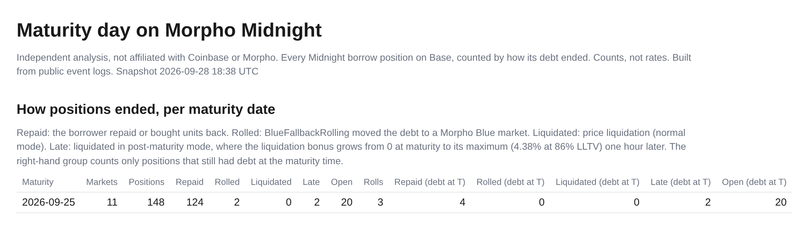
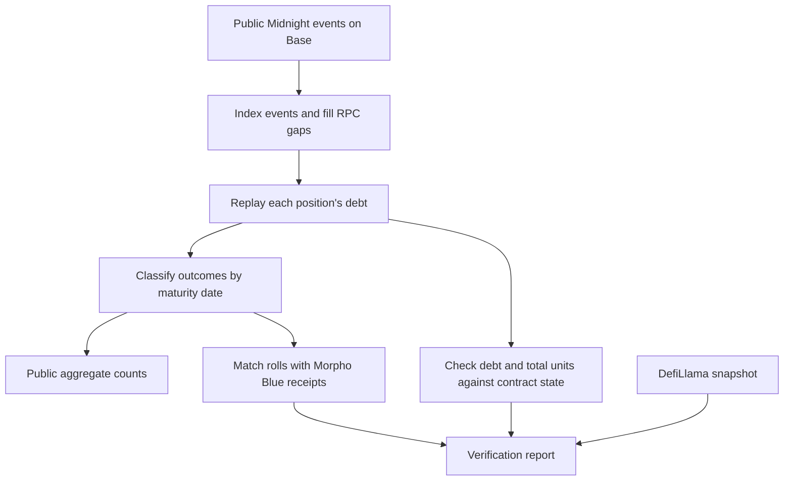

# Spine Midnight: how Morpho Midnight fixed-maturity loans on Base end

[](LICENSE)



Spine Midnight is an independent study of Morpho Midnight, the fixed-maturity loan contract on Base. It reads public contract events, replays the debt of every borrow position, and counts how positions end at each maturity date: repaid, rolled into Morpho Blue, liquidated, or still open. It checks the replay against contract state on Base, Morpho Blue borrow receipts and DefiLlama. It is the companion to [Spine](https://github.com/RahilBhavan/spine), which tracks the Coinbase-linked Morpho Blue loan book on Base and backtests its liquidations. Spine Midnight applies the same approach to the fixed-maturity product.

## Results

The 25 Sep 2026 maturity is the first published checkpoint. Counts come from `data/midnight/maturity.json` (key `2026-09-25`), generated 28 Sep 2026 at 18:38 UTC.

| Outcome | Positions | Meaning |
| :--- | ---: | :--- |
| Repaid | 124 | The borrower repaid the debt or bought the units back. |
| Rolled into Morpho Blue | 2 | `BlueFallbackRolling` moved the debt to a Morpho Blue loan. |
| Liquidated after maturity | 2 | A liquidation in post-maturity mode removed the debt. |
| Still open | 20 | Debt remained at the indexed block. |
| **Total** | **148** | Every indexed position for this maturity, across 11 markets. |

- The `Roll` event log has 3 roll events for this maturity.
- 26 of the 148 positions still had debt at the maturity time: 4 later repaid, 2 were liquidated late, and 20 stayed open.
- The same aggregate covers 67 maturity dates from 9 Jul 2026 to 31 Dec 2028. 38 of them had matured at the snapshot.
- These are position counts across the whole market. They are not a Coinbase wallet breakdown, current balances, or loss estimates.

The 30 Oct 2026 maturity and the final two-maturity report are pending.

## How it works



- `spine/fetch_midnight.py` pulls Midnight and `BlueFallbackRolling` events from Blockscout and resumes from the saved block. A sweep of the public Base RPC then fills logs that Blockscout missed.
- `spine/midnight.py` replays debt and credit per (market, borrower) in log order and labels what removed each position's last debt. It writes the aggregate to `data/midnight/maturity.json`.
- `spine/check_maturity.py` checks the replay. It prints PASS, FAIL or SKIP per check and exits 1 on any failure.

| Check | What must agree |
| :--- | :--- |
| Event replay | Each `Take` event's `totalUnitsDelta` matches the credit replay. |
| Contract state | Replayed debt and `totalUnits` match contract reads at the indexed Base block. |
| Maturity timing | Contract debt at maturity plus one hour matches the replay. |
| Rolls | Each roll's Morpho Blue borrow equals the debt plus incentive, with the Midnight repay in the same transaction. |
| Priced borrowed tokens | The indexed borrowed value is within 2% of DefiLlama at its snapshot time. |

The DefiLlama check leaves out loan tokens that DefiLlama does not price and prints them. One is a token named Dummy USD Coin, with 250,000 units borrowed in the indexed data. This study assigns no USD value or risk to that token.

## Run it

You need Python 3.12 or later. The scripts use only the standard library. The tests need `pytest`.

```sh
git clone https://github.com/RahilBhavan/spine-midnight.git
cd spine-midnight
python3.12 -m venv .venv
.venv/bin/python -m pip install pytest
.venv/bin/python -m pytest -q tests
```

Expected result: `5 passed` (observed on 21 Oct 2026 with Python 3.12.14, and on 24 Oct 2026 with Python 3.14.7). The tests run offline on a synthetic event log and on the committed aggregate.

To refresh the event index, rebuild the September aggregate, and run the checks:

```sh
.venv/bin/python -m spine.fetch_midnight
.venv/bin/python -m spine.midnight label 2026-09-25
.venv/bin/python -m spine.check_maturity 2026-09-25
```

These commands need network access to Blockscout, the public Base RPC and DefiLlama. No API key is required. `BLOCKSCOUT_API_KEY` is optional and only shortens the wait between Blockscout calls. The maturity check reads past contract state, so it needs an RPC that serves historical calls. A skipped check is not a pass.

On 24 Oct 2026, a refresh attempt from one Linux host failed: Blockscout answered every keyless request with HTTP 403 (a Cloudflare challenge page), and the fetcher exited with `blockscout getLogs failed after retries` after about 10 minutes. The committed index is therefore still the 28 Sep 2026 one. Retry from another network, or set `BLOCKSCOUT_API_KEY`.

Run `spine.fetch_midnight` before `spine.check_maturity`. The DefiLlama check compares against DefiLlama's latest snapshot, so it fails against an old index. On 21 Oct 2026, the checker run against the committed 28 Sep index passed every other check, including all 148 positions at maturity plus one hour and all 43 rolls. The DefiLlama check failed with a 34.23% gap. On 24 Oct 2026 it failed again with a 36.71% gap, and every other check passed.

## Repository layout

| Path | Contents |
| :--- | :--- |
| `spine/` | Fetcher, replay and labels, checker, and the HTTP and wallet-tagging helpers copied from Spine. |
| `data/midnight/` | Indexed event files, the RPC sweep marker and the aggregate `maturity.json`. The scripts generate these files. |
| `tests/` | Pytest tests for the replay, labels, penalty rule, aggregate shape, block search and Blockscout fallback. |
| `midnight/` | `maturity.html`, a draft results page. It is marked `noindex` and is not deployed. |
| `site/` | The stylesheet that the draft page uses. |
| `docs/` | The README figure. |

Change the producer scripts rather than editing files in `data/midnight/`. Raw on-chain integers are stored as JSON strings.

## Documentation

- [`MIDNIGHT.md`](MIDNIGHT.md): the research runbook. It lists every command and its output, the timing plan for the 30 Oct 2026 maturity, and the publication gate.

## Sources

- **Events.** The [Blockscout](https://base.blockscout.com) API for Base, filtered to the Morpho Midnight contract `0xAdedD8ab6dE832766Fedf0FaC4992E5C4D3EA18A` and `BlueFallbackRolling` at `0x7bfA8207B818cc0e23a7aBdCBe56572fAbCa831F`. The public Base RPC (`mainnet.base.org`) fills gaps.
- **Range.** From block 48,286,884 (the Midnight deployment) to block 51,915,660. The last fetch ran on 28 Sep 2026 at 18:37 UTC.
- **Prices.** DefiLlama (`api.llama.fi` and `coins.llama.fi`). The checker reads prices live and does not store them.
- **Freezing.** The repository commits the event files and the aggregate as JSON. They have no content hashes. The `fetched_at` and `generated_at` fields record when each file was made.

## Scope and limits

- This is independent research. It is not affiliated with or endorsed by Coinbase or Morpho.
- Only the 25 Sep 2026 checkpoint is published. The 30 Oct 2026 maturity and the final report are pending.
- Public results are aggregate counts with no wallet-type split. They do not estimate any party's exposure or losses.
- Wallet tags and live snapshots stay in the gitignored `private/` directory and are not part of this repository.
- The draft page in `midnight/` is not deployed. It goes live only after the runbook's publication gate.
- CI runs only the offline pytest suite (`.github/workflows/tests.yml`). It has not run on GitHub yet. The live maturity checks run by hand because they need network access.

## License

[MIT](LICENSE). The license covers this project's code. On-chain data and DefiLlama data belong to their sources.

Part of [Rahil Bhavan's projects](https://github.com/RahilBhavan).
