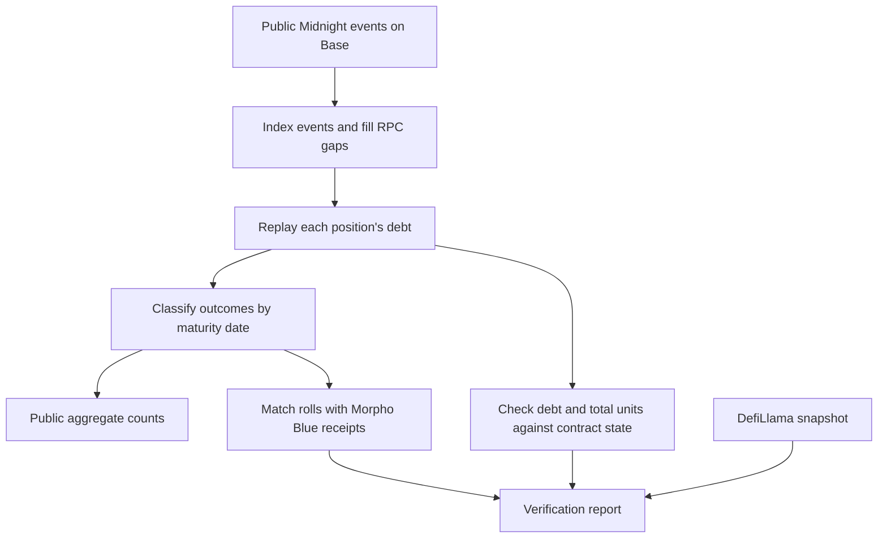

# Spine Midnight
### What happens when a fixed-maturity loan comes due?

An independent study of **Morpho Midnight on Base**. Spine Midnight reads public contract events, reconstructs loan balances, and counts how positions end: repayment, a roll into Morpho Blue, liquidation, or debt still open.

[September results](#september-checkpoint) · [How it works](#how-it-works) · [Reproduce](#reproduce-the-checkpoint) · [Research runbook](MIDNIGHT.md)

> **Research status:** The September 25, 2026 checkpoint is published. The October 30 maturity and final two-maturity report remain pending. This project is not affiliated with Coinbase or Morpho.

## September checkpoint

**148 positions · 11 markets · maturity date: September 25, 2026**

| Outcome | Positions | Meaning |
| :--- | ---: | :--- |
| Repaid | **121** | Debt was repaid without a classified roll. |
| Rolled into Morpho Blue | **2** | The position moved into a Morpho Blue loan. |
| Liquidated after maturity | **20** | A post-maturity liquidation cleared the debt (18 within 10 minutes). |
| Still open | **0** | Debt above the dust threshold remained at the saved index. |
| Dust loan, never repaid | **5** | Borrowed at most the dust threshold ($1) and never cut it. |
| **Total** | **148** | All indexed positions for this maturity. |

Source: [saved aggregate](data/midnight/maturity.json), relabelled **October 22, 2026** from the events indexed on September 28. These are position counts across the market, not a Coinbase wallet breakdown. They describe the saved checkpoint; they are not current balances or estimates of losses.

**Correction (October 22, 2026).** The first version of this table counted 20 positions as still open and 2 as liquidated after maturity. Liquidators leave sub-cent remainders (52 to 773 USDC units, at most $0.0008), and the old labeller treated any remainder as open debt. Outcomes are now set by the first debt cut after the last borrow that leaves at most a **$1 dust threshold** (`DUST_UNITS` in `spine/midnight.py`). 21 positions had a post-maturity liquidation; 20 ended with one. The 21st repaid to $0.011 four days before maturity, and only that remainder was liquidated. Little debt was left by maturity: about $1.3k of USDC was still owed at maturity (24 positions; largest $1,002), although positions had peaked at about $1.85M combined before most were repaid early.

## How it works



The fetcher resumes from its saved block. A public RPC sweep fills gaps in the Blockscout event index. The replay then rebuilds balances from those events.

The checks compare reconstructed balances with contract state at the indexed block. They also check historical debt at maturity plus one hour and match roll transactions with Morpho Blue borrow receipts.

## Reproduce the checkpoint

Use **Python 3.12**. Production scripts use the Python standard library; tests require `pytest`.

```sh
git clone https://github.com/RahilBhavan/spine-midnight.git
cd spine-midnight
python3 -m venv .venv
.venv/bin/python -m pip install pytest
.venv/bin/python -m pytest -q tests
```

To refresh the public event index, rebuild the September aggregate, and run the live checks:

```sh
.venv/bin/python -m spine.fetch_midnight
.venv/bin/python -m spine.midnight label 2026-09-25
.venv/bin/python -m spine.check_maturity 2026-09-25
```

Live checks need public Base RPC and DefiLlama access. Historical checks need an RPC that can read past contract state. A skipped check is not a successful verification.

## What is checked?

| Check | Evidence |
| :--- | :--- |
| Event replay | Reconstructed debt and total units agree with the indexed events. |
| Contract state | Replayed debt and total units match the indexed Base block. |
| Maturity timing | Historical debt is checked at maturity plus one hour. |
| Rolls | Midnight roll transactions match Morpho Blue borrow receipts. |
| Priced borrowed tokens | Values are compared with DefiLlama at its snapshot time. |

The DefiLlama check excludes an unpriced Dummy USD Coin loan token: **250,000 units at the September 28 snapshot**. The checker prints these exclusions. This study assigns no USD value or risk estimate to that token.

See [the runbook](MIDNIGHT.md) for commands, snapshot timing, and the publication gate.

## Explore the repository

| Path | Purpose |
| :--- | :--- |
| [`spine/fetch_midnight.py`](spine/fetch_midnight.py) | Fetch public events and complete the RPC sweep. |
| [`spine/midnight.py`](spine/midnight.py) | Replay balances and classify maturity outcomes. |
| [`spine/check_maturity.py`](spine/check_maturity.py) | Check the replay against independent data. |
| [`data/midnight/`](data/midnight/) | Saved public event data and aggregate results. |
| [`tests/test_midnight.py`](tests/test_midnight.py) | Tests for the maturity logic. |
| [`MIDNIGHT.md`](MIDNIGHT.md) | Research runbook and publication requirements. |

Generated chain data belongs in `data/midnight/`. Change the producer rather than editing generated files. Raw on-chain integers are stored as JSON strings.

## Scope and next checkpoint

- **Published:** September 25 aggregate checkpoint and reproducible research code.
- **Pending:** October 30 maturity and the final two-maturity writeup.
- **Private:** Wallet tags and snapshots under the ignored `private/` directory.
- **Draft:** The local HTML page is not deployed. The page and final memo require the runbook's review and publication checks.

Public results contain aggregate counts and no wallet-type split. They do not estimate any party's exposure or losses.

The original Morpho Blue dashboard and liquidation backtest live in [Spine](https://github.com/RahilBhavan/spine). This repository reuses its API and wallet-tagging helpers.

[MIT license](LICENSE)

